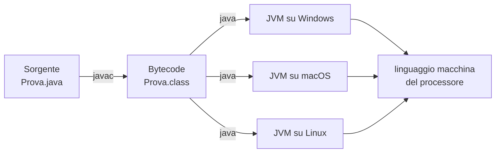

# Capitolo 1 — Java e la JVM

## Di cosa parla questo capitolo

Prima di scrivere una sola riga di Java conviene sapere che cosa succede a quella riga: dove viene salvata, chi la traduce, chi la esegue e perché lo stesso programma gira senza modifiche su Windows, macOS e Linux. Questo capitolo risponde a queste domande partendo dalle basi, cioè da come è fatto un computer e da che cosa sia un linguaggio di programmazione, e arriva alla soluzione scelta da Java: un compilatore che produce *bytecode* e una macchina virtuale, la JVM, che lo esegue.

Poi passiamo alla pratica. Leggiamo riga per riga un primo programma completo, impariamo i due comandi `javac` e `java`, vediamo com'è organizzato un file sorgente (commenti, `import`, classi, il metodo `main`) e quali sono i tre tipi di errore che un programma può contenere. Chiude il capitolo un primo sguardo alla programmazione a oggetti, che i capitoli successivi svilupperanno per intero, e una sezione sulla forma che un file Java deve avere all'esame scritto, dove tutto il codice di un esercizio sta in un solo file.

Alla fine del capitolo saprai spiegare la differenza tra codice sorgente, bytecode e codice macchina, compilare ed eseguire un programma, riconoscere ogni parte della firma di `main` e scrivere un file con più classi che compila al primo tentativo.

## 1.1 Hardware e software

Un sistema di calcolo è fatto di due parti. L'**hardware** è la parte tangibile: i circuiti, lo schermo, la tastiera. Il **software** è l'insieme dei **programmi**, cioè delle sequenze di istruzioni che il computer segue. Per programmare non serve essere esperti di elettronica, ma qualche nozione sull'hardware aiuta a capire perché il software è fatto in un certo modo.

Quasi tutti i computer moderni hanno gli stessi componenti:

- **dispositivi di input** (tastiera, mouse), da cui arrivano i dati;
- **dispositivi di output** (schermo, stampante), su cui escono i risultati;
- un **processore**, detto anche **CPU** (*Central Processing Unit*, unità centrale di elaborazione), che esegue le istruzioni dei programmi;
- due tipi di **memoria**: la memoria principale e la memoria ausiliaria.

Il processore sa eseguire soltanto istruzioni molto semplici: sommare due numeri, confrontarli, copiare un valore da un punto all'altro della memoria. La potenza di un computer non viene dalla complessità delle singole istruzioni, ma dalla velocità con cui ne esegue miliardi e dalla struttura dei programmi che le combinano.

### 1.1.1 Memoria principale e memoria ausiliaria

La memoria conserva tre cose: i programmi, i dati su cui lavorano e i risultati intermedi dei calcoli. Ne esistono due tipi, con ruoli diversi.

La **memoria principale**, o **RAM** (*Random Access Memory*, memoria ad accesso casuale), è la memoria di lavoro. Contiene il programma in esecuzione in questo momento, i dati che sta usando e i risultati parziali. Si misura in gigabyte (un computer tipico ne ha 8 o 16).

La **memoria ausiliaria**, detta anche memoria secondaria, comprende dischi, chiavette USB, DVD. È più o meno permanente (*non volatile*): il suo contenuto resta anche a computer spento. Si misura in gigabyte o terabyte.

> [!NOTE]
> **Definizione — Bit, byte, indirizzo**
> Un **bit** è una cifra che vale 0 oppure 1. Un **byte** è un gruppo di 8 bit. La memoria principale è una lunga sequenza di byte, e ogni byte si trova in una posizione numerata, il suo **indirizzo**.

Qualunque informazione, che siano numeri, lettere, testi, audio, video o programmi, viene codificata con sequenze di 0 e 1. Quando un dato non sta in un byte se ne usano diversi adiacenti, e l'indirizzo del primo byte diventa l'indirizzo dell'intero dato. Si usano proprio due soli simboli perché è facile costruire circuiti con due stati stabili (acceso e spento); per fortuna la traduzione dei dati in bit avviene in modo automatico e il programmatore non deve occuparsene.

Nella memoria ausiliaria i byte sono raggruppati in **file**, ciascuno con un nome, e i file sono organizzati in **cartelle** (*directory*). Anche i programmi Java sono salvati in file. Per eseguire un programma, il suo file viene copiato dalla memoria ausiliaria a quella principale: il processore lavora solo su ciò che si trova in RAM.

## 1.2 Programmi, sistema operativo e linguaggi

Un **programma** è un insieme di istruzioni che il computer deve seguire. Seguire quelle istruzioni si dice **eseguire** il programma (*run*, *execute*). Il computer riceve due tipi di input: il programma stesso e i **dati** di cui il programma ha bisogno. L'**output** è ciò che il programma produce seguendo le istruzioni sui dati.

Tra l'utente e i programmi c'è un programma speciale, il **sistema operativo** (Windows, macOS, Linux, UNIX), che supervisiona il funzionamento del computer: tra le altre cose è lui che recupera un programma dalla memoria ausiliaria e lo avvia quando lo chiediamo.

### 1.2.1 Linguaggi di alto e di basso livello

I programmi si scrivono in **linguaggi di alto livello**, come Java, C, C++, C#, Python: sono relativamente facili da usare per un essere umano, perché somigliano a un linguaggio naturale molto rigoroso. Il guaio è che l'hardware non li capisce. Il processore conosce soltanto il proprio **linguaggio macchina**, fatto di istruzioni elementari codificate in binario. Un programma di alto livello va quindi **tradotto** in un **linguaggio di basso livello** (linguaggio macchina o *assembly*, la sua forma leggibile) prima di poter essere eseguito.

> [!NOTE]
> **Definizione — Compilatore**
> Un **compilatore** è un programma che traduce un programma scritto in un linguaggio di alto livello in un programma equivalente in un linguaggio di basso livello. Il programma di partenza si chiama **programma sorgente** (*source program*), quello prodotto **programma oggetto** (*object program*). *Compilare* un programma significa eseguire il compilatore sul suo sorgente.

Questo schema ha un difetto. Il linguaggio macchina cambia da un processore all'altro, e un programma eseguibile dipende anche dal sistema operativo. Per la maggior parte dei linguaggi serve quindi un compilatore diverso per ogni tipo di computer e per ogni sistema operativo, e i compilatori sono programmi grandi e costosi da realizzare. Soprattutto, chi distribuisce un programma deve compilarlo e distribuirlo separatamente per ogni piattaforma.

## 1.3 Il bytecode e la Java Virtual Machine

Java risolve il problema della sezione precedente con un'idea semplice: aggiungere un passaggio intermedio.

### 1.3.1 Un computer che non esiste

Il compilatore Java **non** traduce il programma nel linguaggio macchina di un computer reale. Lo traduce in **bytecode**, che è il linguaggio macchina di un computer ipotetico, la **Java Virtual Machine** (JVM, macchina virtuale Java). Nessun processore fisico esegue il bytecode direttamente: su ogni computer reale gira un programma, la JVM appunto, che lo legge e lo esegue.

> [!NOTE]
> **Definizione — Bytecode e Java Virtual Machine**
> Il **bytecode** è il linguaggio in cui il compilatore Java traduce i programmi: il linguaggio macchina di un computer ipotetico chiamato **Java Virtual Machine**. La **JVM** è il programma che, su un computer reale, esegue il bytecode traducendolo nel linguaggio macchina di quel computer.

Tradurre bytecode in linguaggio macchina è facile, molto più che tradurre direttamente Java. Il modo più semplice per farlo è un **interprete**: un programma che prende un'istruzione di bytecode, la traduce in istruzioni macchina, le esegue, e solo dopo passa all'istruzione successiva. Tradurre ogni volta le stesse istruzioni però costa tempo, soprattutto quando un pezzo di programma viene ripetuto migliaia di volte. Per questo oggi la maggior parte dei programmi Java viene eseguita con un **compilatore JIT** (*Just-In-Time*, "appena in tempo"): il bytecode viene compilato in linguaggio macchina man mano che serve, e il risultato viene conservato per riusarlo senza doverlo ricompilare.

> [!TIP]
> **Intuizione — Lo spartito e il musicista**
> Pensa al bytecode come a uno spartito e alla JVM come a un musicista. Il compositore scrive lo spartito una volta sola, e qualunque musicista che sappia leggere la notazione lo può suonare, sul proprio strumento. Allo stesso modo il bytecode si produce una volta, e qualunque computer con una JVM lo esegue con il proprio processore. L'analogia ha un limite: un musicista interpreta, mentre la JVM deve produrre esattamente lo stesso comportamento su ogni macchina.

### 1.3.2 Portabilità

Da qui segue la proprietà più importante di Java. Una volta compilato in bytecode, un programma si può eseguire su **qualsiasi** computer dotato di una JVM, **senza ricompilarlo**. Il bytecode si può spedire attraverso Internet e usare ovunque nel mondo: è la ragione per cui Java si è affermato con le applicazioni per Internet. Chi deve fare il lavoro specifico per ogni piattaforma non è più il programmatore, ma chi realizza la JVM per quella piattaforma, una volta per tutte.

Il percorso completo di un programma Java, dal file scritto dal programmatore all'esecuzione, è questo:



A parole: il programmatore scrive il sorgente in un file `.java`; il compilatore `javac` lo traduce in bytecode, in un file `.class`; quello stesso file `.class` viene eseguito dal comando `java`, che avvia la JVM installata sul computer, qualunque esso sia; la JVM traduce il bytecode nel linguaggio macchina del processore su cui sta girando.

### 1.3.3 Un po' di storia

L'idea del linguaggio intermedio è nata da un problema concreto. Nel 1991 James Gosling e la Sun Microsystems iniziarono a progettare un linguaggio per gli elettrodomestici: tostapane, televisori e simili. La difficoltà era che ogni elettrodomestico è controllato da un processore diverso. La soluzione fu tradurre i programmi prima in un linguaggio intermedio comune a tutti i processori, e da questo nel linguaggio macchina del singolo apparecchio. I produttori di elettrodomestici non si mostrarono interessati, ma nel 1994 Gosling si accorse che lo stesso linguaggio era ideale per un browser web capace di eseguire programmi scaricati da Internet, dove i computer collegati sono di ogni tipo. Sun realizzò così il browser HotJava, e Java uscì dal laboratorio.

## 1.4 Compilare ed eseguire: `javac` e `java`

Un programma Java è fatto di uno o più pezzi chiamati **classi**. Che cosa sia una classe lo vedremo con calma nel [Capitolo 7 — Classi e oggetti](07-classi-e-oggetti.md); per ora basta sapere che è un blocco di codice racchiuso tra graffe e introdotto dalla parola `class`, e che i metodi (le azioni che il programma sa compiere) stanno dentro le classi.

Le classi di un programma vanno compilate prima di eseguirlo. Fanno eccezione le classi che accompagnano Java, come `System` e `Scanner`, che sono già compilate e pronte all'uso. Le regole di base sono tre:

1. ogni classe sta di norma in un file separato, e **il nome del file è uguale al nome della classe**, con estensione `.java`;
2. compilando un file, il compilatore produce per ogni classe un file di bytecode con lo stesso nome e l'estensione `.class` al posto di `.java`;
3. un programma può avere quante classi si vuole, ma la classe da cui parte l'esecuzione contiene da qualche parte il metodo `public static void main(String[] args)`.

I due comandi sono:

- **`javac`**, il compilatore: traduce il sorgente in bytecode;
- **`java`**, che avvia la JVM sul bytecode di una classe e ne esegue il metodo `main`.

#### Esempio — Compilare ed eseguire da terminale

Supponiamo di avere il file `FirstProgram.java` (lo leggeremo riga per riga nella sezione 1.5). Da un terminale aperto nella cartella del file:

```bash
javac FirstProgram.java   # compila: se non ci sono errori, crea FirstProgram.class
java FirstProgram         # esegue: avvia la JVM sulla classe FirstProgram
```

Il primo comando riceve il **nome del file**, con l'estensione `.java`. Se il sorgente non contiene errori, `javac` non stampa nulla e lascia nella cartella il file `FirstProgram.class`. Il secondo comando riceve invece il **nome della classe**, senza estensione: la JVM cerca il file `FirstProgram.class`, lo carica ed esegue il suo `main`.

> [!WARNING]
> **Attenzione — `java` vuole il nome della classe, non del file**
> Scrivere `java FirstProgram.class` non funziona: la JVM interpreta `FirstProgram.class` come il nome di una classe (la classe `class` nel package `FirstProgram`) e risponde
> `Error: Could not find or load main class FirstProgram.class`
> seguito da `Caused by: java.lang.ClassNotFoundException: FirstProgram.class`. Il comando corretto è `java FirstProgram`.

Nella pratica di tutti i giorni si usa spesso un **IDE** (*Integrated Development Environment*, ambiente di sviluppo integrato), un programma che unisce un editor di testo ai comandi per compilare ed eseguire. Sotto, però, l'IDE esegue esattamente questi due passaggi.

### 1.4.1 Il class loader

Abbiamo detto che ogni classe viene compilata separatamente, anche da autori diversi, in un proprio file `.class`. Al momento dell'esecuzione qualcuno deve mettere insieme questi pezzi: quando il `main` di una classe usa un'altra classe, il bytecode di quest'ultima deve essere trovato e caricato. Se ne occupa in automatico il **class loader** (caricatore di classi), il componente della JVM che negli altri linguaggi si chiama *linker*. Non dobbiamo chiamarlo noi: la JVM carica una classe la prima volta che serve.

#### Esempio — Un file, due classi, due file `.class`

Questo file, `Programma.java`, contiene due classi. `Programma` ha il `main`; `Saluto` ha un metodo che stampa un messaggio.

```java
public class Programma {
    public static void main(String[] args) {
        Saluto s = new Saluto();   // crea un oggetto della classe Saluto
        s.saluta();                // gli chiede di eseguire il metodo saluta
    }
}

class Saluto {                     // seconda classe, senza public
    void saluta() {
        System.out.println("Ciao!");
    }
}
```

Compilandolo con `javac Programma.java`, nella cartella compaiono **due** file di bytecode, `Programma.class` e `Saluto.class`: uno per classe, anche se il sorgente era uno solo. Eseguendo `java Programma`, la JVM carica `Programma.class`, comincia il `main` e, quando incontra `new Saluto()`, il class loader carica `Saluto.class`. L'output è:

```text
Ciao!
```

Se provassimo `java Saluto`, la JVM caricherebbe la classe ma si fermerebbe subito con `Error: Main method not found in class Saluto`, perché `Saluto` non ha un `main` da cui partire. Torneremo sulla regola delle classi `public` nella sezione 1.10.

## 1.5 Anatomia di un primo programma

Leggiamo ora un programma completo. Saluta l'utente, gli chiede due numeri interi e ne stampa la somma.

#### Esempio — `FirstProgram`

```java
import java.util.Scanner;                         // rende disponibile la classe Scanner

public class FirstProgram                         // inizio della classe FirstProgram
{
    public static void main(String[] args)        // punto di partenza del programma
    {
        System.out.println("Hello out there.");   // stampa una riga sullo schermo
        System.out.println("I will add two numbers for you.");
        System.out.println("Enter two whole numbers on a line:");

        int n1, n2;                               // due variabili intere

        Scanner keyboard = new Scanner(System.in); // oggetto che legge dalla tastiera
        n1 = keyboard.nextInt();                  // legge il primo intero
        n2 = keyboard.nextInt();                  // legge il secondo intero

        System.out.println("The sum of those two numbers is");
        System.out.println(n1 + n2);              // stampa il risultato della somma
    }                                             // fine di main
}                                                 // fine della classe
```

Se l'utente scrive `12 30` e preme Invio, lo schermo mostra (la quarta riga è quella digitata dall'utente):

```text
Hello out there.
I will add two numbers for you.
Enter two whole numbers on a line:
12 30
The sum of those two numbers is
42
```

Vediamo il programma pezzo per pezzo.

**`import java.util.Scanner;`** Un **package** è una libreria di classi già scritte. `Scanner`, la classe che legge l'input da tastiera, sta nel package `java.util`, e questa riga dice al compilatore che nel file useremo `Scanner` chiamandola per nome breve. Ne parliamo nella sezione 1.5.4.

**`public class FirstProgram`** Apre la definizione della classe `FirstProgram`. Tutto ciò che sta tra la graffa aperta della riga successiva e l'ultima graffa chiusa del file appartiene alla classe. Poiché la classe è `public`, il file deve chiamarsi `FirstProgram.java`.

**`public static void main(String[] args)`** È l'intestazione del metodo `main`, il punto da cui parte l'esecuzione. Ne analizziamo ogni parola nella sezione 1.5.2. Le istruzioni del programma sono tra le graffe che seguono.

**`System.out.println("Hello out there.");`** `System.out` è un oggetto che invia output allo schermo, e `println` è un suo metodo che stampa ciò che sta tra le parentesi e poi va a capo. Il testo tra virgolette doppie è una **stringa**, stampata così com'è.

**`int n1, n2;`** Dichiara due **variabili**, cioè due contenitori in cui il programma può memorizzare dati, di tipo `int` (numeri interi). Le variabili sono l'argomento del [Capitolo 2 — Tipi primitivi, variabili e operatori](02-tipi-variabili-operatori.md).

**`Scanner keyboard = new Scanner(System.in);`** Crea un oggetto `Scanner` collegato a `System.in`, l'input standard (la tastiera), e lo chiama `keyboard`. Le due righe successive gli chiedono di leggere un intero ciascuna con il metodo `nextInt`. L'input da console è trattato nel [Capitolo 3 — Stringhe e input/output da console](03-stringhe-e-console.md).

**`System.out.println(n1 + n2);`** Questa volta tra le parentesi non c'è una stringa ma un'espressione: Java calcola `n1 + n2` e stampa il risultato, `42`.

### 1.5.1 Un po' di terminologia

Il programma ci permette di fissare alcuni termini che useremo sempre.

- Chi scrive il programma è il **programmatore**; chi lo usa è l'**utente**.
- Un'**istruzione** (*statement*) è un ordine dato al computer, e in Java termina con un punto e virgola `;`.
- Le regole grammaticali di un linguaggio di programmazione formano la sua **sintassi**. Sono molto più rigide di quelle di una lingua naturale.
- Ciò che sta tra le parentesi di una chiamata di metodo sono gli **argomenti**: le informazioni di cui il metodo ha bisogno per fare il suo lavoro. In `println("Hello out there.")` l'argomento è la stringa.

Una chiamata di metodo ha sempre la forma

```text
nomeOggetto.nomeMetodo(argomenti)
```

e si dice che il programma **invoca** (o **chiama**) il metodo sull'oggetto: l'oggetto compie l'azione corrispondente. In `System.out.println("Ciao")` l'oggetto è `System.out`, il metodo è `println`, l'argomento è `"Ciao"`. Il punto separa l'oggetto dal metodo.

> [!NOTE]
> **Approfondimento esterno — Che cos'è davvero `System.out`**
> `out` è un campo della classe `System`, del package `java.lang`, dichiarato come
> `public static final PrintStream out`
> e descritto come lo stream di output "standard". È quindi un oggetto della classe `PrintStream` (package `java.io`), ed è `static`: si raggiunge attraverso il nome della classe, `System.out`, senza creare oggetti. In modo simmetrico `System.in` è dichiarato `public static final InputStream in`, lo stream di input standard. Il metodo che usiamo per stampare ha firma
> `public void println(String x)`
> e "stampa una `String` e poi termina la riga"; si comporta come una chiamata a `print(String)` seguita da `println()`. Nessuno di questi metodi dichiara eccezioni: un `PrintStream` non lancia mai `IOException`.
> *Fonte:* [Java SE 17 — `System`](https://docs.oracle.com/en/java/javase/17/docs/api/java.base/java/lang/System.html#out), [Java SE 17 — `PrintStream.println(String)`](https://docs.oracle.com/en/java/javase/17/docs/api/java.base/java/io/PrintStream.html#println(java.lang.String))

### 1.5.2 Il metodo `main`

Un'applicazione Java è una collezione di classi, e **una** di esse contiene il metodo `main`: il punto di ingresso da cui la JVM comincia l'esecuzione. Quando scriviamo `java FirstProgram`, la JVM cerca nella classe `FirstProgram` un metodo con esattamente questa intestazione:

```java
public static void main(String[] args)
```

Ogni parola ha un ruolo preciso, e la maggior parte la capiremo fino in fondo solo più avanti:

| Parola | Significato | Approfondito nel |
|---|---|---|
| `public` | il metodo è accessibile dall'esterno della classe, quindi anche dalla JVM | [Capitolo 7](07-classi-e-oggetti.md) |
| `static` | il metodo appartiene alla classe e si può chiamare senza creare un oggetto: all'avvio non esiste ancora nessun oggetto | [Capitolo 6 — Metodi](06-metodi.md) |
| `void` | il metodo non restituisce alcun valore | [Capitolo 6](06-metodi.md) |
| `main` | il nome che la JVM cerca; non si può cambiare | — |
| `String[] args` | il parametro: un array di stringhe con gli eventuali argomenti scritti dopo il nome della classe sulla riga di comando | [Capitolo 5 — Array e matrici](05-array-e-matrici.md) |

Il nome del parametro, `args`, è una convenzione: `main(String[] a)` funziona allo stesso modo. Tutto il resto invece va scritto così com'è. Se l'intestazione è diversa, per esempio `main(String args)` senza le parentesi quadre, il file **compila** (è un metodo valido, solo che non è il `main` che la JVM cerca) ma l'esecuzione si ferma subito con:

```text
Error: Main method not found in class Prova, please define the main method as:
   public static void main(String[] args)
or a JavaFX application class must extend javafx.application.Application
```

### 1.5.3 La struttura di un file sorgente

Un file `.java` ha una struttura fissa. Dall'alto verso il basso contiene:

1. **la dichiarazione del package** (facoltativa): `package nome;`, che dichiara a quale package appartengono le classi del file. Se c'è, deve essere la prima istruzione del file;
2. **le istruzioni `import`** (facoltative), una per riga;
3. **un commento di intestazione** (facoltativo, ma consigliato) che spiega che cosa fa il file;
4. **una o più definizioni di classe**.

La **riga di definizione di una classe** contiene, nell'ordine: un modificatore di accesso facoltativo (per esempio `public`), la parola chiave `class`, il nome della classe, una clausola `extends` facoltativa e una clausola `implements` facoltativa (le vedremo nei capitoli [9](09-ereditarieta-e-polimorfismo.md) e [10](10-classi-astratte-e-interfacce.md)). Segue il **corpo della classe**, la parte tra le graffe, che contiene tutti i campi e tutti i metodi.

La dichiarazione `package` e le istruzioni `import` stanno **fuori** dalle graffe della classe. Dentro la classe, invece, deve stare tutto il resto: in Java non esistono metodi o variabili "sciolti" al primo livello del file. Questa regola ha conseguenze pratiche importanti all'esame, e la riprendiamo nella sezione 1.10.

### 1.5.4 Package e `import`

Un **package** è un meccanismo per raggruppare classi collegate tra loro. Java assume che tutte le classi di uno stesso package si trovino nella stessa cartella, e la libreria standard di Java (la *Java API*) è organizzata in molti package predefiniti: `java.util` (utilità come `Scanner`), `java.io` (input e output su file), `javax.swing` (interfacce grafiche) e così via.

Ogni classe ha un **nome completo** (*fully qualified name*), formato dal nome del package, un punto e il nome della classe: il nome completo di `Scanner` è `java.util.Scanner`. L'istruzione `import` permette di usare una classe con il suo nome breve invece di scrivere ogni volta il nome completo. I due programmi seguenti sono equivalenti.

```java
import java.util.Scanner;   // da qui in poi basta scrivere Scanner

public class ConImport {
    public static void main(String[] args) {
        Scanner tastiera = new Scanner(System.in);
        System.out.println("Pronto a leggere.");
    }
}
```

```java
public class SenzaImport {
    public static void main(String[] args) {
        // senza import si usa il nome completo, ogni volta che serve
        java.util.Scanner tastiera = new java.util.Scanner(System.in);
        System.out.println("Pronto a leggere.");
    }
}
```

Entrambi stampano `Pronto a leggere.`. Il primo è più leggibile, ed è la forma che si usa sempre.

Perché allora `System` si usa senza nessun `import`? Perché `System` appartiene al package **`java.lang`**, che contiene le classi fondamentali del linguaggio (`String`, `System`, `Math`, `Integer`…) e viene **importato implicitamente** in ogni file Java. Tutte le altre classi della libreria vanno importate.

> [!TIP]
> **Intuizione — Nome e cognome**
> Il nome completo di una classe è come nome e cognome di una persona: `java.util.Scanner` identifica la classe senza ambiguità, come "Anna Rossi". L'`import` è come presentarla all'inizio di una conversazione: da lì in poi basta dire "Anna". Il package `java.lang` è la famiglia di casa, che non serve presentare.

> [!WARNING]
> **Attenzione — L'`import` con l'asterisco**
> Si può importare un intero package con `import java.util.*;`. Funziona, ma nasconde da quale package arriva ogni classe. In questi appunti gli `import` sono sempre espliciti, una classe per riga, così si vede subito che cosa serve e da dove viene. Il ruolo dei package nel controllo dell'accesso alle classi è trattato nel [Capitolo 7](07-classi-e-oggetti.md).

### 1.5.5 I commenti

I programmi migliori si spiegano da soli, grazie a uno stile pulito e a nomi scelti bene. Quando non basta, si aggiungono **commenti**: testo scritto per chi legge il programma, che il compilatore ignora completamente. In Java esistono tre forme.

- **Commento di riga**: comincia con `//` e prosegue fino alla fine della riga.
- **Commento su più righe**: comincia con `/*` e finisce con `*/`; tutto ciò che sta in mezzo è ignorato, anche se occupa molte righe. È comodo anche per "spegnere" temporaneamente un pezzo di codice durante il debug (*commentarlo*). I commenti di questo tipo **non si possono annidare**: il primo `*/` chiude il commento, qualunque cosa ci sia prima.
- **Commento javadoc**: comincia con `/**` e finisce con `*/`. Ha la stessa sintassi del precedente, ma uno strumento apposito (`javadoc`) lo estrae automaticamente per produrre la documentazione del programma.

#### Esempio — Le tre forme di commento

```java
/*
 * Programma: area di un cerchio.
 * Calcola l'area di un cerchio di raggio noto e la stampa.
 * Ultima modifica: 3 novembre 2026.
 */
public class AreaCerchio {

    /** Punto di partenza del programma: calcola l'area e la stampa. */
    public static void main(String[] args) {
        double raggio = 2.0;                        // in centimetri
        double area = 3.14159 * raggio * raggio;   // area = pi greco per raggio al quadrato
        // System.out.println("debug: " + area);   riga spenta con un commento
        System.out.println(area);
    }
}
```

Il commento in testa è il **commento di intestazione**: è buona norma aprire ogni file spiegando che cosa fa il programma, chi l'ha scritto, come contattarlo e la data dell'ultima modifica. Per il resto si commenta solo ciò che un lettore esperto non capirebbe dal codice. L'output è:

```text
12.56636
```

## 1.6 Applicazioni e applet

Storicamente i programmi Java erano di due tipi. Le **applicazioni** sono programmi normali, pensati per essere eseguiti sul proprio computer: partono dal metodo `main`. Le **applet** erano piccole applicazioni pensate per essere spedite attraverso Internet ed eseguite dentro una pagina web, e non avevano un `main`. Oggi le applet sono **deprecate** da Oracle e non sono più supportate dai browser, che usano HTML5 e JavaScript al loro posto. In questi appunti scriviamo soltanto applicazioni.

## 1.7 Progettare, collaudare, correggere

### 1.7.1 Algoritmi

Progettando i metodi, il programmatore stabilisce quali azioni sanno compiere gli oggetti. Il modo di compiere un'azione è descritto da un **algoritmo**: un insieme di istruzioni per risolvere un problema, espresso in modo **completo e preciso**. Gli algoritmi si scrivono di solito in linguaggio naturale o in **pseudocodice**, un misto di linguaggio naturale e costrutti di programmazione. Una volta definito l'algoritmo, tradurlo in Java (o in un altro linguaggio) è di solito la parte facile.

#### Esempio — Il costo totale di una lista di acquisti

Un algoritmo per calcolare il costo totale degli articoli di una lista:

1. scrivi il numero 0 sulla lavagna;
2. per ogni articolo della lista, somma il suo costo al numero scritto sulla lavagna e sostituisci quel numero con il risultato;
3. annuncia che il totale è il numero scritto sulla lavagna.

La lavagna è ciò che in un programma sarà una variabile, e il passo 2 diventerà un ciclo ([Capitolo 4 — Strutture di controllo](04-strutture-di-controllo.md)).

### 1.7.2 Riuso del software

La maggior parte dei programmi non nasce da zero: si costruisce combinando componenti che esistono già. Riusare componenti fa risparmiare tempo e denaro, e i componenti già usati da altri sono di solito più curati e più affidabili. Per questo le classi nuove vanno progettate in modo generale, perché possano servire anche ad altre applicazioni. Java stesso fornisce moltissime classi pronte, organizzate in package e descritte da una documentazione ufficiale che per ogni classe riporta il package, il nome e la descrizione dei metodi.

### 1.7.3 Tre tipi di errore

Un errore in un programma si chiama **bug**, ed eliminarlo si dice **debugging**. Il modo migliore di eliminare gli errori è non commetterli: progettare con cura classi, algoritmi e metodi, tradurli in Java con attenzione, e poi **collaudare** il programma con casi di prova scelti bene (alcuni dei quali con risposta nota), correggere gli errori trovati e ricollaudare. Gli errori sono di tre tipi, che si distinguono per *quando* vengono scoperti.

> [!NOTE]
> **Definizione — Errori di sintassi, di esecuzione e logici**
> - Un **errore di sintassi** viola le regole grammaticali del linguaggio. Lo scopre il **compilatore**, che stampa un messaggio di errore e non produce il bytecode.
> - Un **errore di esecuzione** (*runtime error*) non viene scoperto durante la compilazione ma mentre il programma gira: la JVM interrompe il programma e stampa un messaggio di errore.
> - Un **errore logico** non viene scoperto né dal compilatore né durante l'esecuzione: il programma gira fino in fondo ma produce risultati sbagliati.

#### Esempio — Un errore di sintassi

Manca il punto e virgola alla fine dell'istruzione.

```java
public class Punto {
    public static void main(String[] args) {
        System.out.println("x")      // ERRORE: manca il ;
    }
}
```

Il compilatore risponde indicando il file, la riga e, con il segno `^`, il punto esatto in cui si è accorto del problema:

```text
Punto.java:3: error: ';' expected
        System.out.println("x")
                               ^
1 error
```

Il compilatore segnala il punto in cui *si accorge* dell'errore, che non sempre coincide con il punto in cui l'errore è stato commesso: se il messaggio non sembra avere senso sulla riga indicata, conviene guardare anche la riga precedente.

#### Esempio — Un errore di esecuzione

Il programma compila, ma divide per zero.

```java
public class Divisione {
    public static void main(String[] args) {
        int a = 10;
        int b = 0;
        System.out.println(a / b);   // divisione intera per zero
    }
}
```

La compilazione va a buon fine; durante l'esecuzione la JVM si ferma alla riga 5:

```text
Exception in thread "main" java.lang.ArithmeticException: / by zero
	at Divisione.main(Divisione.java:5)
```

Il messaggio dice che è stata sollevata un'**eccezione** di tipo `ArithmeticException` nel metodo `main`, alla riga 5 del file. Le eccezioni hanno un capitolo tutto loro, il [Capitolo 13 — Eccezioni](13-eccezioni.md).

#### Esempio — Un errore logico

Per convertire una temperatura da gradi Celsius a gradi Fahrenheit si moltiplica per 9/5 e si somma 32. Questo programma somma 23 per sbaglio.

```java
public class Temperatura {
    public static void main(String[] args) {
        double celsius = 100.0;
        double fahrenheit = celsius * 9 / 5 + 23;   // sbagliato: andava sommato 32
        System.out.println(fahrenheit);
    }
}
```

Compila ed esegue senza problemi, e stampa:

```text
203.0
```

Il risultato corretto è 212.0, perché l'acqua bolle a 100 °C, cioè a 212 °F. Nessuno strumento automatico può accorgersene: solo un caso di prova con risposta nota rivela l'errore. È per questo che all'esame l'output atteso riportato nella traccia va confrontato con attenzione con quello prodotto.

## 1.8 Uno sguardo alla programmazione a oggetti

Il mondo è fatto di **oggetti**: persone, alberi, automobili, città, prenotazioni aeree. Gli oggetti compiono **azioni** che hanno effetto su loro stessi e sugli altri oggetti. La **programmazione orientata agli oggetti** (OOP, *Object-Oriented Programming*) tratta un programma allo stesso modo: come una collezione di oggetti che interagiscono attraverso azioni.

Nel vocabolario di Java le azioni si chiamano **metodi**. Gli oggetti dello stesso tipo appartengono alla stessa **classe**: hanno gli stessi metodi e lo stesso tipo di dati, ma ogni oggetto ha i **propri valori**. Due automobili della stessa classe sanno entrambe accelerare e frenare, ma ognuna ha la propria targa e il proprio colore.

La programmazione a oggetti si regge su tre principi di progettazione.

**Incapsulamento.** I dati e i metodi di una classe sono "chiusi in una capsula", e solo una parte del contenuto è resa accessibile dall'esterno. Chi usa la classe sa *come usarla*, ma non vede *come funziona dentro*. Per questo l'incapsulamento si chiama anche **information hiding** (occultamento dell'informazione).

> [!TIP]
> **Intuizione — Il guidatore e il motore**
> Un'automobile è fatta di moltissimi componenti. Al guidatore interessa conoscere l'acceleratore, il freno e il volante; gli iniettori, il sistema di frenata automatica o la pompa del servosterzo non gli interessano, e può guidare benissimo senza saperne nulla. Una classe ben incapsulata mostra a chi la usa i pedali e il volante, e tiene nascosto il motore.

**Polimorfismo.** Dal greco "molte forme": la stessa istruzione assume significati diversi a seconda del contesto. In concreto, lo stesso nome di metodo produce risultati che dipendono dalla classe dell'oggetto che lo esegue. Un'analogia dalla vita quotidiana: l'invito "prenditi del tempo per svagarti" porta persone diverse a fare attività diverse.

**Ereditarietà.** Le classi si possono organizzare in una gerarchia. Una classe dei livelli più bassi **eredita** tutte le caratteristiche delle classi che le stanno sopra, e a ogni livello si aggiungono caratteristiche nuove che la rendono più specializzata. Pensiamo a una gerarchia di veicoli: in cima c'è il veicolo generico; sotto ci sono le automobili, le moto e gli autobus, che sono veicoli con qualcosa in più; sotto le automobili ci possono essere le berline e le cabriolet. Le classi alte sono più generali e comprendono più oggetti, quelle basse sono più specifiche. In Java l'ereditarietà serve a organizzare le classi: le caratteristiche ereditate non vanno riscritte, si aggiungono solo quelle nuove.

Questi tre principi sono il cuore del corso. L'incapsulamento è sviluppato nel [Capitolo 7](07-classi-e-oggetti.md), ereditarietà e polimorfismo nel [Capitolo 9](09-ereditarieta-e-polimorfismo.md) e nel [Capitolo 10](10-classi-astratte-e-interfacce.md).

## 1.9 La JVM in memoria

Abbiamo visto che la JVM esegue il bytecode. Mentre lo fa, organizza la memoria che il sistema operativo le assegna in diverse zone, che insieme formano la **run-time data area** (area dei dati di esecuzione):

- per ogni flusso di esecuzione (ogni *thread*, vedi sotto) c'è un **program counter**, che indica l'istruzione in esecuzione, e uno **stack**, che contiene le variabili locali dei metodi in corso;
- lo **heap** contiene gli **oggetti**, creati dinamicamente durante l'esecuzione (per esempio con `new`), condivisi tra i thread e rimossi automaticamente dal *garbage collector* quando non servono più;
- la **method area** è la zona in cui il **class loader** carica i file `.class`, con la descrizione di ogni classe: i suoi campi, i suoi metodi, il bytecode.

Un **thread** è un flusso di esecuzione indipendente: un programma può averne diversi, che lavorano contemporaneamente, ciascuno con il proprio stack ma tutti con lo stesso heap. Per ora i nostri programmi hanno un solo thread, quello che esegue `main`.

Questa mappa della memoria tornerà utile due volte: nel [Capitolo 8 — Riferimenti e memoria](08-riferimenti-e-memoria.md), per capire la differenza tra una variabile e l'oggetto a cui si riferisce, e nel [Capitolo 17 — Thread](17-thread.md), per capire perché più thread che lavorano sullo stesso oggetto possono interferire tra loro.

## 1.10 La forma di un programma all'esame

All'esame scritto tutte le classi di un esercizio si scrivono in **un unico file**, in un'area di testo senza controllo della sintassi. La sezione 1.4 diceva che ogni classe sta di norma in un file separato: è la convenzione dei progetti veri, ma non un obbligo del linguaggio. Le regole che Java impone davvero sono queste.

1. **Un file contiene solo classi** (e interfacce, che vedremo nel [Capitolo 10](10-classi-astratte-e-interfacce.md)), oltre a `package` e `import`. Metodi e variabili stanno sempre **dentro** il corpo di una classe. Un metodo scritto al primo livello del file non compila.
2. **Un file può contenere più classi**, una dopo l'altra. Il compilatore produce un file `.class` per ciascuna (sezione 1.4.1).
3. **Al più una classe del file può essere `public`**, e in quel caso il file deve avere il suo nome. Le altre classi si scrivono senza modificatore.

Ne segue una regola pratica: se la traccia non impone il modificatore `public`, le classi di un esercizio d'esame si scrivono **senza `public`**. In questo modo il file compila qualunque nome gli venga dato. Se una classe è `public` e il file ha un altro nome, o se le classi `public` sono due, il compilatore si ferma.

#### Esempio — Una classe con un metodo statico, nella forma corretta

Supponiamo di dover scrivere un metodo statico che converte minuti in secondi, dentro una classe `Orologio`. La classe è tutto il file, e il metodo sta dentro le sue graffe:

```java
class Orologio {                              // la classe avvolge il metodo
    static int minutiInSecondi(int minuti) {  // static: si chiama senza creare oggetti
        return minuti * 60;
    }
}
```

Questo file compila anche se non contiene nessun `main`: il `main` serve solo per *eseguire* una classe, non per compilarla. All'esame il `main` spesso non va scritto, perché lo fornisce il test che verifica il codice. Per provarlo da soli si aggiunge una seconda classe con il `main` nello stesso file:

```java
public class ProvaOrologio {                  // l'unica public, come il nome del file
    public static void main(String[] args) {
        System.out.println(Orologio.minutiInSecondi(3));   // chiamata tramite il nome della classe
    }
}

class Orologio {
    static int minutiInSecondi(int minuti) {
        return minuti * 60;
    }
}
```

Il file si chiama `ProvaOrologio.java`; l'output è:

```text
180
```

La chiamata `Orologio.minutiInSecondi(3)` usa il nome della classe seguito dal punto, senza creare oggetti, perché il metodo è `static`. È la stessa forma di `System.out`, che è un campo `static` della classe `System`. I metodi statici sono trattati nel [Capitolo 6 — Metodi](06-metodi.md).

> [!WARNING]
> **Attenzione — Il messaggio di errore cambia con la versione di Java**
> Un metodo scritto fuori da ogni classe produce sempre un errore di compilazione, ma il testo del messaggio dipende dalla versione del compilatore. Con Java 17 il messaggio è `class, interface, enum, or record expected`. Le versioni più recenti accettano in certi casi file senza classe dichiarata (le *classi dichiarate implicitamente*), e il messaggio parla di quella funzionalità: `implicitly declared classes are not supported in -source 17` oppure `compact source file does not have main method in the form of void main() or void main(String[] args)`. La causa è la stessa e anche il rimedio: mettere il metodo dentro una classe.

## Come esce all'esame

**Appello dell'8 settembre 2026 (EXAM4) — Esercizio 3, logica di base.** La traccia chiedeva di definire una classe `Convertitore` e, al suo interno, un metodo `converti` "invocabile senza creare un oggetto" che riceve una distanza in chilometri (intero) e restituisce l'equivalente in metri (intero). L'output atteso mostrava i risultati di alcune chiamate, tra cui valori nulli e negativi. Servono: la regola per cui un metodo sta sempre dentro una classe (sezione 1.10), la parola chiave `static` per un metodo che si chiama senza oggetti (sezione 1.5.2 e [Capitolo 6](06-metodi.md)), il tipo `int` ([Capitolo 2](02-tipi-variabili-operatori.md)). Vincoli letterali: il nome della classe e del metodo, i tipi del parametro e del valore restituito, il metodo statico.

**EXAM2 — Esercizio 1, logica di base.** Stessa sostanza: un metodo statico con firma data, `public static int converti(int km)`, che converte chilometri in metri. La traccia indicava soltanto la firma del metodo, ma il metodo va comunque scritto dentro una classe perché il file compili. Vincolo letterale: la firma, da copiare esattamente.

Esercizi di questo tipo valgono pochi punti e sembrano banali, ma mettono alla prova proprio la forma del file: un metodo corretto scritto fuori da una classe non compila, e l'esercizio non produce alcun output.

## Errori tipici

> [!CAUTION]
> **Errore tipico — Un metodo fuori da ogni classe**
> ```java
> // ERRORE: il metodo non sta dentro nessuna classe
> public static int doppio(int n) {
>     return n * 2;
> }
> ```
> In Java ogni metodo appartiene a una classe. Il file non compila: con Java 17 il messaggio è `class, interface, enum, or record expected` (sulle versioni più recenti il testo cambia, vedi sezione 1.10). Forma corretta:
> ```java
> class Calcoli {
>     public static int doppio(int n) {
>         return n * 2;
>     }
> }
> ```

> [!CAUTION]
> **Errore tipico — Due classi `public` nello stesso file**
> ```java
> // file Prova.java
> public class Prova {
>     public static void main(String[] args) { }
> }
> public class Altra { }   // ERRORE: seconda classe public
> ```
> Il compilatore risponde `class Altra is public, should be declared in a file named Altra.java`. Lo stesso errore compare se l'unica classe `public` ha un nome diverso da quello del file (`public class Ciao` nel file `Saluto.java`). Forma corretta: al più una classe `public`, con il nome del file; le altre senza modificatore (`class Altra { }`).

> [!CAUTION]
> **Errore tipico — Intestazione di `main` sbagliata**
> ```java
> public class Prova {
>     public static void main(String args) {   // ERRORE: manca []
>         System.out.println("x");
>     }
> }
> ```
> Il file compila, perché è un metodo valido, ma non è il `main` che la JVM cerca. L'esecuzione si ferma con `Error: Main method not found in class Prova, please define the main method as: public static void main(String[] args)`. Forma corretta, da scrivere sempre identica: `public static void main(String[] args)`.

> [!CAUTION]
> **Errore tipico — Maiuscole e minuscole**
> ```java
> system.out.println("x");                       // ERRORE: system minuscolo
> public static void main(string[] args) { }     // ERRORE: string minuscolo
> ```
> Java distingue maiuscole e minuscole: `System` e `system` sono nomi diversi. Il primo frammento produce `package system does not exist`, il secondo `cannot find symbol` con `symbol: class string`. Forma corretta: `System.out.println("x");` e `String[] args`. I nomi delle classi cominciano con la maiuscola.

> [!CAUTION]
> **Errore tipico — Punto e virgola mancante**
> ```java
> System.out.println("x")   // ERRORE: manca ;
> ```
> Ogni istruzione termina con `;`. Il compilatore risponde `';' expected` e indica con `^` il punto in cui se ne accorge, che può essere alla fine della riga o all'inizio della successiva. Forma corretta: `System.out.println("x");`.

> [!CAUTION]
> **Errore tipico — Virgolette tipografiche copiate da un documento**
> ```java
> System.out.println(“ciao”);   // ERRORE: virgolette curve
> ```
> Copiando una stringa da un PDF o da un programma di videoscrittura si portano dietro le virgolette tipografiche `“ ”` al posto di quelle dritte `"`. Per il compilatore sono caratteri sconosciuti: `illegal character: '“'`, `illegal character: '”'` e altri errori a catena. Forma corretta: `System.out.println("ciao");`, con le virgolette dritte della tastiera.

> [!CAUTION]
> **Errore tipico — Commenti `/* */` annidati**
> ```java
> /* commento esterno
>    /* commento interno */
>    ancora testo           // ERRORE: qui il commento è già chiuso
> */
> ```
> Il primo `*/` chiude il commento, quindi `ancora testo` e l'ultimo `*/` vengono letti come codice. Il compilatore protesta con errori che sembrano senza senso, per esempio `';' expected` sulla riga `ancora testo`. Forma corretta: per spegnere un pezzo di codice che contiene già un commento `/* */`, usare `//` su ogni riga.

## Riassunto

Un computer esegue solo il linguaggio macchina del proprio processore, mentre i programmi si scrivono in linguaggi di alto livello, che vanno tradotti da un compilatore. Il compilatore tradizionale produce codice legato a un processore e a un sistema operativo. Java aggiunge un livello: il compilatore `javac` produce bytecode, il linguaggio di un computer ipotetico, e su ogni computer reale una Java Virtual Machine lo esegue, interpretandolo o compilandolo al volo con il JIT. Il risultato è che lo stesso file `.class` gira ovunque ci sia una JVM, senza ricompilazione. Un programma Java è fatto di classi: ogni classe compilata produce un file `.class`, il class loader le carica quando servono e l'esecuzione parte dal metodo `public static void main(String[] args)`. Un file sorgente contiene package, `import` e classi, e tutto il resto sta dentro le classi; un file può contenere più classi, ma al più una `public`, con il nome del file. Gli errori si dividono in errori di sintassi, scoperti dal compilatore, errori di esecuzione, scoperti dalla JVM, ed errori logici, che solo un collaudo con risultati noti rivela. Infine la programmazione a oggetti vede un programma come una collezione di oggetti che interagiscono, e si regge su incapsulamento, polimorfismo ed ereditarietà.

**Concetti chiave**

- **Hardware e software**: la parte fisica del computer e i programmi che esegue. Il processore lavora sulla memoria principale (RAM); i file risiedono nella memoria ausiliaria.
- **Compilatore**: traduce un programma sorgente di alto livello in un programma oggetto di basso livello. Di solito ne serve uno per ogni processore e sistema operativo.
- **Bytecode**: il linguaggio in cui `javac` traduce i programmi Java, contenuto nei file `.class`. È il linguaggio macchina della JVM.
- **JVM**: il programma che esegue il bytecode su un computer reale, con un interprete o con un compilatore JIT.
- **Portabilità**: il bytecode si esegue su qualsiasi computer con una JVM, senza ricompilare.
- **`javac` e `java`**: `javac NomeFile.java` compila e produce un `.class` per ogni classe; `java NomeClasse` esegue il `main` di quella classe.
- **Class loader**: il componente della JVM che carica le classi nella method area quando servono.
- **`main`**: il punto di ingresso del programma, con intestazione fissa `public static void main(String[] args)`. Se è diversa, il file compila ma non parte.
- **Struttura di un file**: `package` (facoltativo, per primo), `import`, classi. Metodi e variabili solo dentro le classi.
- **`import` e `java.lang`**: l'`import` permette di usare il nome breve di una classe; il package `java.lang` (con `System` e `String`) è importato implicitamente.
- **Commenti**: `//` fino a fine riga, `/* */` su più righe (non annidabili), `/** */` per la documentazione javadoc.
- **Tre tipi di errore**: di sintassi (compilatore), di esecuzione (JVM, il programma si interrompe), logici (risultato sbagliato, nessun messaggio).
- **OOP**: oggetti che interagiscono tramite metodi; classi come tipi di oggetti; incapsulamento, polimorfismo, ereditarietà.
- **Run-time data area**: stack e program counter per ogni thread, heap per gli oggetti condivisi, method area per le classi caricate.
- **Forma all'esame**: tutte le classi in un file, nessun metodo fuori da una classe, nessuna classe `public` se la traccia non la chiede.

**API essenziali**

| Classe | Membro | Dichiarazione | Eccezioni |
|---|---|---|---|
| `java.lang.System` | `out` | `public static final PrintStream out` | — |
| `java.lang.System` | `in` | `public static final InputStream in` | — |
| `java.io.PrintStream` | `println` | `public void println(String x)` | nessuna |
| (classe di avvio) | `main` | `public static void main(String[] args)` | — |
